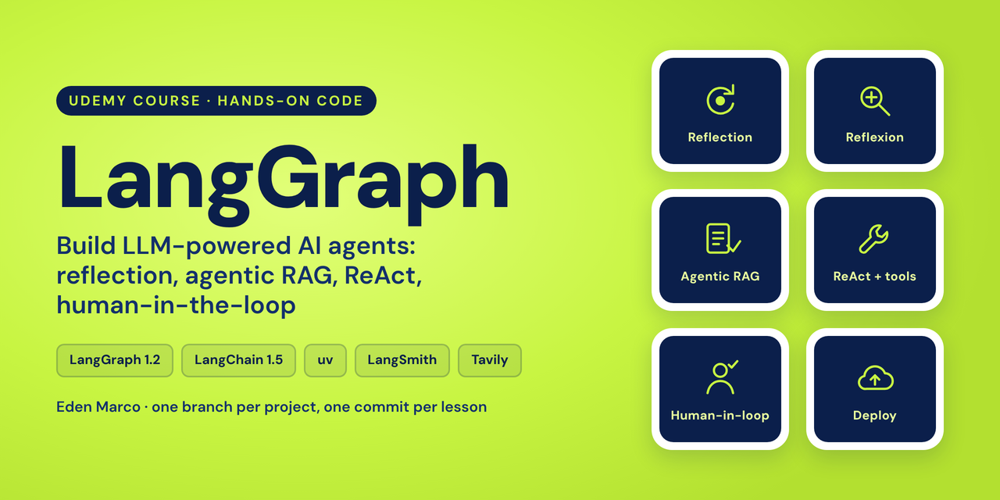

# LangGraph — Develop LLM-Powered AI Agents



[](https://www.udemy.com/course/langgraph/?couponCode=NOV-2026)
[](https://www.udemy.com/course/langgraph/)
[](https://www.udemy.com/course/langgraph/?couponCode=NOV-2026)
[](https://twitter.com/EdenEmarco177)

> The hands-on companion to the Udemy course **[LangGraph- Develop LLM powered AI agents with LangGraph](https://www.udemy.com/course/langgraph/?couponCode=NOV-2026)**.
> Every branch is a project, every commit is a lesson. Check out a branch, then run `git log --oneline` to follow the lessons commit by commit.

---

## 🚀 What you'll build

- **Reflection agent** — a generate/critique loop that improves its own output
- **Reflexion agent** — an actor that critiques itself, searches the web with Tavily and revises with citations
- **Agentic RAG** — Corrective RAG, Self-RAG and Adaptive RAG with document grading, web search and a question router
- **ReAct agent** — reasoning plus tool calling with LangGraph's `ToolNode`
- **Persistence and human-in-the-loop**, **parallel (fan-out/fan-in) execution**, and running graphs with **LangGraph Studio and LangSmith Deployment**

Built on **LangGraph 1.2**, **LangChain 1.5** and **Python 3.13**, managed with **[uv](https://docs.astral.sh/uv/)**.

---

## 🗂️ Repository map

| Branch | Course section | Project |
|--------|----------------|---------|
| [`project/reflection-agent`](https://github.com/emarco177/langgraph-course/tree/project/reflection-agent) | 3 · Reflection Agent | Tweet writer that reflects on and revises its own drafts |
| [`project/reflexion-agent`](https://github.com/emarco177/langgraph-course/tree/project/reflexion-agent) | 4 · Reflexion Agent | Researcher with self-critique, Tavily search and cited revisions |
| [`project/agentic-rag`](https://github.com/emarco177/langgraph-course/tree/project/agentic-rag) | 5 · Agentic RAG Flows | Corrective, Self and Adaptive RAG over a Chroma vector store |
| [`project/ReAct-Agent-Function-Calling`](https://github.com/emarco177/langgraph-course/tree/project/ReAct-Agent-Function-Calling) | 6 · ReAct AgentExecutor | ReAct loop with function calling and `ToolNode` |
| [`project/ReAct-agent`](https://github.com/emarco177/langgraph-course/tree/project/ReAct-agent) | 6 (earlier version) | The same ReAct agent, with the full lesson history from the prompt-based version |

---

## 📚 Lesson by lesson: `project/agentic-rag`

| # | Commit | Lesson |
|---|--------|--------|
| 1 | [`80323ce`](https://github.com/emarco177/langgraph-course/commit/80323ce) | Start here |
| 2 | [`3490983`](https://github.com/emarco177/langgraph-course/commit/3490983) | Project structure (uv) |
| 3 | [`12bd85e`](https://github.com/emarco177/langgraph-course/commit/12bd85e) | Ingestion pipeline (UnstructuredLoader, Chroma) |
| 4 | [`55f26d8`](https://github.com/emarco177/langgraph-course/commit/55f26d8) | Graph state |
| 5 | [`1cb0579`](https://github.com/emarco177/langgraph-course/commit/1cb0579) | Retrieve node |
| 6 | [`ac83fb0`](https://github.com/emarco177/langgraph-course/commit/ac83fb0) | Grade documents node |
| 7 | [`d26339b`](https://github.com/emarco177/langgraph-course/commit/d26339b) | Web search node (Tavily) |
| 8 | [`5b47047`](https://github.com/emarco177/langgraph-course/commit/5b47047) | Generation node |
| 9 | [`b8e0436`](https://github.com/emarco177/langgraph-course/commit/b8e0436) | Wiring the graph |
| 10 | [`e3de720`](https://github.com/emarco177/langgraph-course/commit/e3de720) | Self-RAG |
| 11 | [`da87fe6`](https://github.com/emarco177/langgraph-course/commit/da87fe6) | Adaptive RAG router |

Each project branch has its own README with its lesson table.

---

## ⚡ Quick start

```bash
# 1. Install uv (macOS / Linux; on Windows see https://docs.astral.sh/uv/getting-started/installation/)
curl -LsSf https://astral.sh/uv/install.sh | sh

# 2. Clone and pick a project branch
git clone https://github.com/emarco177/langgraph-course.git
cd langgraph-course
git checkout project/agentic-rag   # for example

# 3. Install the exact versions from uv.lock and run
uv sync
uv run main.py
```

Create a `.env` file in the project folder:

```bash
OPENAI_API_KEY=...
TAVILY_API_KEY=...       # for the web-search lessons
LANGSMITH_API_KEY=...    # optional, for tracing
LANGSMITH_TRACING=true   # optional
```

---

> Run the commands from the project folder (the one with `pyproject.toml`), so imports like `from ingestion import retriever` resolve.

---

## 💼 Level-up your career: LangJobs 🦜

Looking for your next role building agents, RAG apps or LangGraph integrations? Check the **[LangJobs.dev](https://langjobs.dev/)** board, built for the 150,000-strong AI engineering community. Post a job or explore openings that use the exact stack you're learning here.

---

## 🤝 Join the community

- 💬 **Course Q&A and Discord** for questions and project feedback
- 🐙 **GitHub Issues**: bugs, ideas and PRs welcome
- 🛠️ **Bonus repos**: extra templates and utilities for course alumni

> All future updates are free. Your one-time enrollment grows with the ecosystem.

---

## 🙏 Acknowledgements

Big thanks to the **LangChain / LangGraph** team and their [documentation](https://docs.langchain.com/oss/python/langgraph/overview), which makes this course possible.

## 📄 License

[MIT](LICENSE)
